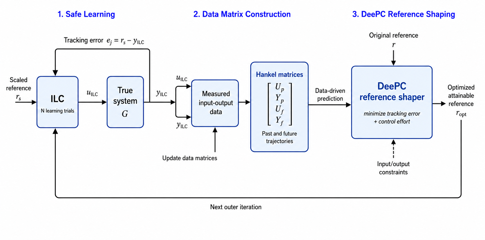
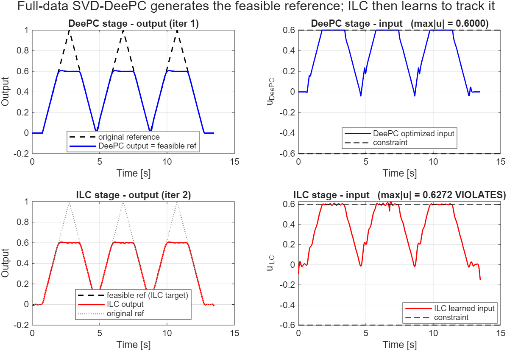
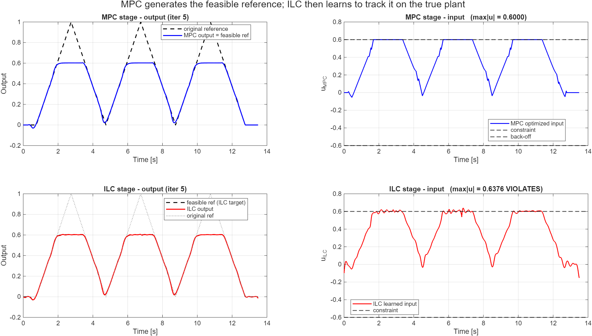

#Learning-Based Predictive Control

**Hybrid Framework Combiining Iterative Learning Control (ILC), Model Predictive Control (MPC), and Data-Enabled Predictive Control (DeePC)**  
National Taiwan University (NTU), Next-generation Automated Surgical Apparatus Lab  
**Supervisor:** Prof. Cheng-Wei Chen  
**Researcher:** Hilal İlhan
September 2026

## Overview

This repository contains MATLAB simulations developed during a research internship at National Taiwan University. The study investigates how **Iterative Learning Control (ILC)** can be combined with **Model Predictive Control (MPC)** or **Data-Enabled Predictive Control (DeePC)** for repeated reference tracking when the control input and its rate of change are constrained.

ILC can improve tracking over repeated trials, but the standalone learning law does not explicitly enforce actuator limits. The combined strategies use MPC or DeePC to generate an attainable, constraint-aware reference, which is then tracked using ILC.


## Approaches

| Method | Purpose | Implementation |
| --- | --- | --- |
| **ILC** | Improve tracking over repeated executions of a triangular reference | PD-type learning law with zero-phase Q-filter |
| **MPC** | Track a reference while constraining the control input | Model-based, receding-horizon controller |
| **DeePC** | Optimize future trajectories directly from offline input/output data | Hankel matrices and quadratic programming |
| **ILC + MPC** | Use ILC measurements to identify a model; use MPC to reshape the reference; track with ILC | System identification + MPC + ILC |
| **ILC + DeePC** | Use ILC input/output data to build a DeePC predictor; reshape the reference; track with ILC | Hankel data + SVD compression + DeePC + ILC |

## Repository contents

```text
.
├── ILC_sim.m                  # Standalone ILC
├── MPC_Sim.m                  # Standalone MPC
├── DeePC_sim.m                # Standalone DeePC
├── ILC_MPC_combined_sim.m     # Combined ILC and MPC
├── ILC_DeePC_combined_sim.m   # Combined ILC and DeePC
├── all_results/              # Simulation plots and block diagrams
└── README.md
```

## Simulation details

- **Plant:** simulated second-order system, discretized at `Ts = 0.01 s`.
- **Reference:** triangular trajectories, with padding used in the ILC-based scripts.
- **ILC:** repeated trials, PD-type learning update, and zero-phase filtering.
- **MPC:** a model-based finite-horizon controller; the combined ILC + MPC code estimates a discrete-time state-space model from ILC data.
- **DeePC:** constructs Hankel matrices from measured input/output trajectories and solves constrained quadratic programs; the combined ILC + DeePC code compresses the trajectory representation with SVD.
- **Constraints:** the studies consider input-amplitude and input-rate limits; parameter values and experimental toggles are defined at the top of individual scripts.

## Before Running

Install MATLAB and the relevant toolboxes:
   - Control System Toolbox
   - Signal Processing Toolbox
   - Optimization Toolbox (for `quadprog`)
   - System Identification Toolbox (for `ILC_MPC_combined_sim.m`)
   - Model Predictive Control Toolbox (for MPC scripts)

## Selected figures

**ILC + DeePC architecture**



**ILC + DeePC simulation**



**ILC + MPC architecture**


**ILC + MPC simulation**




